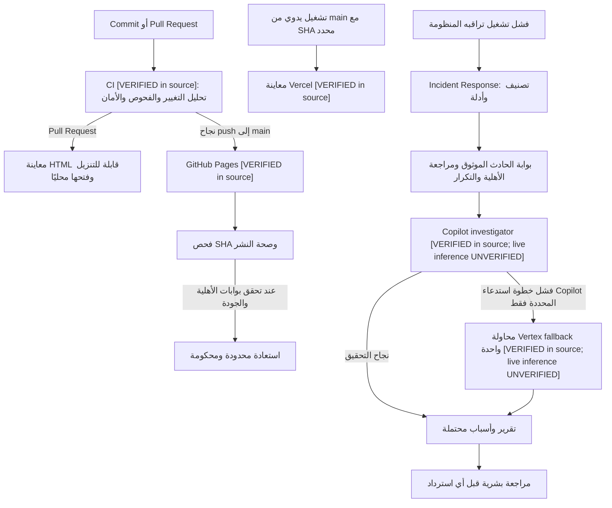

# Devobs AI DevOps Control Room

لوحة معمارية توثيقية لحالة الأتمتة في Devobs. هذه الصفحة ثابتة؛ لا تعرض حالة تشغيل حيّة ولا تستنتج نجاح خدمة من وجود إعدادها في المستودع.

## كيف تسير المنظومة

**VERIFIED (source configuration):** يوضح المخطط مسارات العمل الموثقة في ملفات المستودع. لا يعني ذلك أن أي مزوّد AI نجح في استدعاء حي.



## لوحة الحالة

| المسار | ما يثبته المصدر | الحالة والدليل |
| --- | --- | --- |
| CI وفحوص التغيير | يختار `change-analysis` بعض الفحوص بحسب التغيير؛ فحوص الأمان وعقد الموقع مطلوبة في الملف القياسي. تقدير المخاطر حتمي ولا يستدعي نموذجًا خارجيًا. معاينة PR ملف HTML قابل للتنزيل وليست استضافة عامة. | **VERIFIED (source):** [CI](../.github/workflows/ci.yml) و[Automation Hub](AUTOMATION_HUB.md#L28). **VERIFIED (runtime, merge SHA):** [آخر CI موثق](https://github.com/hamedonassar95/Devobs/actions/runs/39709727211) نجح على SHA الدمج؛ تحقّق من التشغيل الأحدث قبل اعتماد حالة حية لاحقة. |
| GitHub Pages | نشر بعد اجتياز الفحوص على دفعة إلى `main`، ثم فحص SHA وصحة النشر. الاستعادة التلقائية لا تتم إلا بعد اجتياز بوابات الأهلية وفحوص جودة هدف الاستعادة. | **VERIFIED (source):** [Automation Hub](AUTOMATION_HUB.md#L34) و[Deploy Pages](../.github/workflows/deploy-pages.yml). الحالة الحية **UNVERIFIED** هنا. |
| Vercel staging | تشغيل يدوي من `main` مع SHA كامل محدد، ثم معاينة وفحص SHA والمحتوى والمسارات الخاصة. | **VERIFIED (source; manual):** [Vercel staging test](../.github/workflows/vercel-stage-test.yml#L3-L9) و[خطوة فحص المعاينة](../.github/workflows/vercel-stage-test.yml#L148-L154). |
| تحقيق الحوادث بالذكاء الاصطناعي | مسار Copilot للمحقق وVertex كبديل محدود بعد فشل استدعاء Copilot المحدد؛ الناتج للمراجعة البشرية. | **VERIFIED (source):** [AI provider resilience](AI_PROVIDER_RESILIENCE.md#L18-L24) و[Incident Response](INCIDENT_RESPONSE.md#L40-L56). نجاح الاستدلال الفعلي **UNVERIFIED**. |
| فحص المزوّد | فحص Copilot يتحقق من تنسيق الرمز فقط. فحص Vertex يتحقق من Workload Identity والمصادقة. كلاهما لا يثبت أن النموذج أجاب. | **VERIFIED (source):** [AI Provider Preflight](../.github/workflows/ai-provider-preflight.yml) و[INVESTIGATOR_ACCEPTANCE.md](INVESTIGATOR_ACCEPTANCE.md#L249-L254). |
| تنفيذ AI للتغييرات أو الاسترداد | المحقق لا يدمج أو يدفع إلى `main` أو ينفذ rollback. | **VERIFIED (source):** [Incident Response](INCIDENT_RESPONSE.md#L49-L56). التنفيذ الآلي غير مفعّل في هذا المسار. |

يعرض [سجل استراتيجية النماذج والقبول](AI_MODEL_STRATEGY.md) نتائج التشغيل المسجلة. وفق الأدلة المسجلة فيه، لم يصل فحصا Copilot وVertex المذكوران إلى استدلال ناجح؛ لا تعرض هذه اللوحة ذلك على أنه حالة آنية، ولم تُجرَ هنا مراجعة أحدث لتشغيل GitHub Actions.

## كيف نعلن حالة صحيحة

- **VERIFIED (source):** ملفات workflow وإعداداته موجودة وموثقة؛ هذا لا يثبت أن الأسرار أو صلاحيات المزوّد صالحة.
- **VERIFIED (runtime):** يوجد تشغيل حديث مكتمل نفّذ الفعل المقصود، مثل استدعاء نموذج وتلقي استجابة صالحة. نجاح فحص تنسيق الرمز وحده لا يفي بهذا الشرط.
- **UNVERIFIED:** لا يوجد دليل تشغيل يثبت السلوك المطلوب، أو أن الفحص توقف قبل تنفيذه.

لا تعرض هذه الصفحة شارات خضراء لحالة حيّة. يجب ربط أي لوحة لحظية بنتائج GitHub Actions الفعلية، مع وقت التشغيل والـSHA الذي جرى التحقق منه.

## أحدث تحقق بعد الدمج

**VERIFIED (runtime: فحوص المستودع فقط):** دُمج PR [#206](https://github.com/hamedonassar95/Devobs/pull/206) إلى `main` عند commit `6640b4861de1d04ebdc54b1de91f5eaa4d28dfd6` في 2026-10-22. نجح [CI run 39709727211](https://github.com/hamedonassar95/Devobs/actions/runs/39709727211) و[CodeQL run 39709729057](https://github.com/hamedonassar95/Devobs/actions/runs/39709729057) على SHA الدمج. تخطّى [Incident Response run 39709822450](https://github.com/hamedonassar95/Devobs/actions/runs/39709822450) التنفيذ وفق شروطه. هذه النتائج تثبت فحوص المستودع فقط، ولا تثبت استجابة نموذج AI.

**UNVERIFIED (runtime: استدلال Copilot):** لم يظهر أي تشغيل لسير العمل اليدوي `Copilot inference smoke (manual)` عند مراجعة سجل التشغيل في 2026-10-22. لا يوجد حتى الآن إيصال تشغيل يثبت وصول طلب إلى Copilot أو اجتياز الاستجابة عقد JSON.

يتطلب سير العمل أن يكون التشغيل من `main` وبواسطة مالك المستودع، وأن تكون قيمتا `owner_approved=true` و`quota_reviewed=true` في مدخلات التشغيل، وأن تكون `DEVOBS_AI_BUDGET_APPROVED` مساوية لـ`true`. لم تُراجع هذه الصفحة قيم الأسرار أو المتغيرات في إعدادات GitHub. راجع المالك صفحة [استخدام Copilot والإنفاق](https://docs.github.com/en/copilot/how-tos/manage-and-track-spending/monitor-ai-usage) قبل تأكيد مراجعة الحصة؛ لا تُعتبر فحوص CI أو CodeQL مراجعة للميزانية.

## اختبار استدلال محدود — التصميم الموافق عليه، والتشغيل غير معتمد

**الحالة: UNVERIFIED / لم يُشغّل من خلال هذه الصفحة.** هذا سيناريو محدود لا يثبت أن Copilot أو أي نموذج متاح الآن. لا تشغّل الاختبار قبل موافقة صريحة من مالك المستودع على تشغيله.

```text
نفّذ طلب استدلال واحدًا عبر GitHub Copilot على هذا النص التجريبي غير الإنتاجي: “فشل فحص CI لأن ملفًا متوقعًا غير موجود؛ اقترح سببًا محتملًا واحدًا في أقل من 25 كلمة.”
أعد JSON فيه الحالة والتشخيص فقط؛ لا تستخدم أدوات ولا تقرأ المستودع أو الحوادث أو الأسرار أو Google Cloud، ولا تنشئ تعليقًا أو commit أو deployment أو موارد.
```

قبل أي تشغيل، يجب توفير مسار يدوي معزول لـCopilot فقط، بلا أدوات أو كتابة إلى GitHub وبلا Vertex fallback. لا تستخدم المحقق الحالي لهذا الاختبار؛ فهو مرتبط بحادثة موثوقة، وقد يؤدي فشل Copilot إلى تشغيل مسار Vertex الاحتياطي. قد يستهلك الاستدلال حصة Copilot. لا تشغّل الاختبار قبل تفعيل هذه الحدود ومراجعة أثر الحصة.

معيار النجاح: سجل تشغيل يثبت أن طلبًا واحدًا وصل إلى Copilot وأن الاستجابة JSON اجتازت التحقق. بعد تشغيل معتمد، سجّل رابط التشغيل والـSHA والنتيجة والزمن إن توفر فقط؛ لا تسجل الأسرار أو نص المطالبة أو الاستجابة.

## مصادر المستودع

- [CI](../.github/workflows/ci.yml)
- [Deploy Pages](../.github/workflows/deploy-pages.yml)
- [فحص صحة النشر](../.github/workflows/deployment-health-check.yml)
- [Vercel staging test](../.github/workflows/vercel-stage-test.yml)
- [AI Provider Preflight](../.github/workflows/ai-provider-preflight.yml)
- [AI Provider Circuit Breaker](../.github/workflows/ai-provider-circuit-breaker.yml)
- [Automation Hub](AUTOMATION_HUB.md)
- [AI provider resilience](AI_PROVIDER_RESILIENCE.md)
- [Incident Response](INCIDENT_RESPONSE.md)
- [AI model strategy and recorded provider checks](AI_MODEL_STRATEGY.md)
- [Investigator acceptance](INVESTIGATOR_ACCEPTANCE.md)
