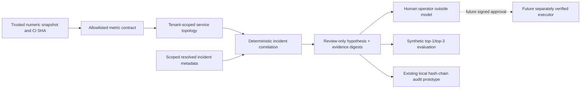

# DevObs AI Intelligence — 2027 System Card / Assurance Matrix

**Revision:** 2026-10-25 (2027 is a target, not a statement of implementation). **Canonical repository:** `hamedonassar95/Devobs`. No other projects, domains or cloud services are substituted.

## Intended use and trust boundaries

DevObs provides guarded DevOps evidence collection, CI review, incident hypothesis proposals and human-review plans. Existing guarded GitHub Actions operate independently of this new offline context layer. The model is **never a source of authorization**. No production shell, deployment, merge, pod restart, scale operation, billing action, or rollback capability is delegated to the new code.

## AI-BOM / model-card essentials

| Item | Real observed state | Next gate |
| --- | --- | --- |
| Agent/model | Existing offline deterministic adviser; optional model callback disabled by default. Other repo workflows have budget approval variables | Record provider name, exact model snapshot, prompts, tool manifest, cost limits and evaluation for **each** live invocation |
| Training / incident memory | New metadata-only, tenant-scoped, closed-vocabulary resolved incident retrieval | Consent, encrypted tenant storage, validated retention and deletions, adversarial memory poisoning tests, vector data handling |
| Evidence data | Numeric allowlisted telemetry with service ID, SHA, timestamp and SHA256 digest | Actual collector, authenticated transport, signed provenance, drift/freshness tests |
| RCA accuracy | Synthetic top-1/top-3 only, denominator surfaced | Human-labelled incidents (minimum 30 for first review; more needed by class), holdout/time-split, calibration, false-positive analysis |
| Human control | Deterministic policy denies execution; proposal review only | Cryptographic approver identity + scope, SHA, parameters, expiration and one-time consumption; deny on ambiguity |
| Audit | Existing SQLite hash-chained metadata; privileged actor can rewrite chain | Immutable external anchor, model/tool version, actor and approval evidence, retention proof |
| Tenant isolation | In-memory scope and signed-token API exist; merged PR #218 adds RLS tests against an ephemeral PostgreSQL service in CI | Live hosted DB isolation, verified identity provider, and negative tenant/queue/storage tests |
| Quality / billing | No measured field ROI, cost/incident or customer billing in this change | Service SLOs, cost tagging, quotas, privacy and license review |

## Graduated autonomy

- **Level 0 (existing):** evidence and triage reads, no mutations.
- **Level 1 (partial existing):** bounded patch/Draft PR suggestions for human review only; no autonomous merge.
- **Level 2 (NOT enabled):** independently signed, one-time per-action human approval is not yet implemented.
- **Level 3 (NOT enabled):** no bounded automatic restart, scaling or rollback; rollback must be tested against known safe versions and independently governed.

Promotion requires audited identity, scoped approvals, post-action outcome verification, policy review, observed utility, reliable emergency kill switch, recovery drills and cost budgets. A synthetic heuristic accuracy score never automatically enables execution.

## Buyer KPIs — exact measurement contracts, no invented values

- **RCA top-1:** labelled incidents with correct first-ranked service / all labelled eligible incidents. Abstentions count as misses; segment by class/tenant/team.
- **RCA top-3:** labelled incidents with expected service in first 3 / all labelled eligible incidents.
- **MTTD:** median time from confirmed onset to first qualified detection; requires synchronized source timestamps.
- **MTTR:** median time from detection to independently confirmed resolution; distinguish service recovery from incident closure.
- **Noise reduction:** (baseline alert count - accepted correlated incidents) / baseline alert count over matched observation windows. Must measure missed incidents.
- **False action rate:** independently adjudicated wrong actions / all executed actions. **Unavailable** while execution is disabled.
- **Human override rate:** human reversals / reviewed model proposals. **Not measured**.
- **Cost per incident:** summed inference + storage + processing + operator costs / processed incidents. **Not measured**.
- **Automated benefit:** compare measured baseline to contemporaneous controlled rollout; no 2027 market forecast counts as evidence.

## Compliance control mapping (NOT certification)

| Framework | Intended control / evidence | Current state |
| --- | --- | --- |
| NIST AI RMF Govern | roles, bounded action authority, risk register, lifecycle decision evidence | PARTIAL — repository docs and policy |
| NIST AI RMF Map / Measure | service context, incident benchmark, class metrics and drift evaluation | PARTIAL — offline synthetic fixtures |
| NIST AI RMF Manage | signed approvals, incident response, model/provider change rollout | BLOCKED — verification and production implementation |
| ISO/IEC 42001 | AI management system governance, impact review, model/data inventory and evaluation | DESIGN ONLY; no AIMS audited |
| ISO/IEC 27001 / SOC 2 | change controls, identity, monitoring, access and data lifecycle | PARTIAL repo CI; no assessment/attestation |
| EU AI Act | applicability classification, transparency, oversight, logging, provider/deployer roles | LEGAL REVIEW REQUIRED; do not assume all provisions apply to DevObs |

Gartner's June 25, 2025 projection that over 40% of agentic projects **may be cancelled by end-2027** is a forecast and is not evidence of actual cancellation or DevObs ROI.

## Security, privacy and limitations

Telemetry adapter consumes a trusted **small numeric metric snapshot**, not the complete OTLP wire format or a public telemetry ingest listener. Evidence hashes are not signatures. Service topology is supplied explicitly, not discovered. Incident-memory lookup is deterministic, not semantic/vector retrieval. A stale SHA or cross-tenant sample is rejected; source authenticity requires a separate trusted connector. Model confidence is not calibrated. Do not send raw customer logs, prompts, credentials, traces, emails, ticket bodies or embeddings to this prototype. Offline incident benchmarks are not production accuracy.

**Review gates:** existing CI/security/CodeQL, versioned fixtures, negative tests and human review. No merging or production deployment as part of this change. GitLab mirroring, GCP, SaaS billing, private customer sources and infrastructure remain unchanged.

## Primary official references

- Gartner projection: https://www.gartner.com/en/newsroom/press-releases/2025-06-25-gartner-predicts-over-40-percent-of-agentic-ai-projects-will-be-canceled-by-end-of-2027
- OpenTelemetry current semantic conventions: https://opentelemetry.io/docs/specs/semconv/
- NIST AI RMF and GenAI profile: https://www.nist.gov/itl/ai-risk-management-framework
- ISO/IEC 42001: https://www.iso.org/standard/81230.html
- OWASP AI Agent Security: https://cheatsheetseries.owasp.org/cheatsheets/AI_Agent_Security_Cheat_Sheet.html
- EU AI Act official FAQ: https://digital-strategy.ec.europa.eu/en/faqs/navigating-ai-act
