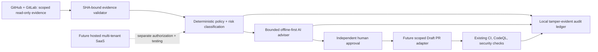

# DevObs Enterprise AI DevOps Intelligence — implementation plan

**Canonical repository:** `hamedonassar95/Devobs` (GitHub). **Working branch:** `feat/ai-devops-enterprise`. **Status:** staged development, **not production-ready**. No relocation or repository replacement.

## Repository audit (2026-10-25)

VERIFIED from GitHub repository: `main` is protected; `.github/CODEOWNERS` and `.github/pull_request_template.md` exist; `.github/workflows/ci.yml` has the required `validate` check, Python tests, security checks, and GitHub Pages deployment. The repository already includes `scripts/devobs_intelligence/{contracts,collectors,policy,state_machine}.py`, existing recovery plans, and GitLab read-only CI auditing. The shipped site is **static HTML**, not a hosted multi-tenant API.

IMPORTANT: existing production Pages deployment on `main` must remain unchanged. Do not overwrite working automation to make a demo appear more complete. Existing semantic-version baseline and release notes do not establish automated release or changelog generation.

## Target architecture



**Trust boundaries:** AI advice is never an authorization token. Block all unverified deployment, merge, rollback, permissions, billing, secrets, and destructive operations; require signed/identity-bound approvals for future narrowly-scoped write capabilities. Never trust log messages, model prompts, PR descriptions, or retrieved runbooks as instructions. The default is read-only and offline; no provider or cloud account is activated by this plan.

## Execution phases and status gates

| Phase | Scope | Safe initial deliverable | Production gate |
|---|---|---|---|
| 1. Foundation | GitHub primary, CODEOWNERS, PR template, conventional commits, versions, changelog | Audit, this plan, release policy, mirror guidance | Require actual protected-branch settings and review enforcement before declaring governance complete |
| 2. CI/CD | Existing actions reused, lint, tests, scanning, SBOM, staged releases | Tests and quality reporting on PR; design a non-deploying SBOM process | No production promotion or rollback without verified environment protection, staging, smoke and manual approval |
| 3. IaC | Terraform + GCP, staging/prod, FinOps | Reviewable example module and state/runbook design only | Separate GCP project resources, state lock, explicit operator billing approval, OIDC and least privilege |
| 4. Runtime | Containers, Compose, Kubernetes/Helm | Review a minimal non-root runtime **after** a real service exists | Probes, limits, policies and isolation tests before enabling deployments |
| 5. DevSecOps | SAST, SBOM, dependency, image, IaC, signatures | Reuse current Bandit, pip-audit, Gitleaks, CodeQL; scope gaps | CI evidence, threat model, verified permissions and signed artifacts |
| 6. Observability | OpenTelemetry, SLO, alerts, runbooks | Offline structured events, SLO/runbook specifications | Hosted storage, retention, alert quality and privacy review |
| 7. AI intelligence | Evidence, anomalies, diagnosis, evaluation, guardrails | Bounded offline adviser and local audit ledger with adversarial fixtures | Measured accuracy/cost and separately approved model provider |
| 8. SaaS | Tenant isolation, SSO/OIDC, RBAC, API, dashboard, billing | Product/API and data-isolation contract (no customer onboarding) | Verified tenant isolation and auth, payments/legal approval, billing idempotency |
| 9. Reliability/compliance | Restore, retention, encryption, SOC2-style checklist | DR/retention/security control templates | Actual restore drills, legal review and independent audit |
| 10. Sales | Demo, pricing, install, license review, SLA | Sample-data-only positioning and known-gap report | No commercial readiness claim without support, security and licensing clearance |

### Phase deliverables committed independently

1. **Foundation:** `docs/PLAN.md`, release and repository-mirroring guide, stage gate. No changes to protected settings or mirror credentials.
2. **AI Intelligence:** add `scripts/devobs_intelligence/adviser.py` and `tests/test_intelligence_adviser.py`; structured, allowlisted offline incident hypothesis only; single bounded optional model callback; kill switch; no tools.
3. **Evidence/audit:** add `scripts/devobs_intelligence/audit_store.py` and `tests/test_intelligence_audit_store.py`; SQLite local idempotency and hash-chain verification; never claim immutable storage against a privileged attacker.
4. **Product/security readiness:** docs and static check tooling as independently reviewable increments; no billing/API/IAM/cloud side effects.
5. **Acceptance:** branch Draft PR, full GitHub `validate`, security and CodeQL; run local tests and report exact exits and exclusions. Do not merge automatically.

## Mandatory controls

- All implementation under `feat/ai-devops-enterprise`; no direct pushes to `main`, no automatic merging.
- No secrets or copied client incidents in code, tests or CI logs.
- GitLab synchronization: GitHub stays canonical. GitLab **pull mirroring** is available only on eligible GitLab plans; GitLab **push mirroring** points from GitLab outward. Do not activate either or configure tokens until the owner chooses an eligible destination. A replica is **not** a backup unless restoration and retention are tested.
- Use conventional commit subjects for new changes; semantic version and changelog proposals must be reviewed. Do not add an automatic publishing job to `main`.
- Preserve existing required `validate` status and `AGENTS.md` fail-closed design.
- Run tests after each code phase and stop on unresolved security failures.
- Manual protection of production is an **external GitHub environment setting**, not something a YAML file alone can prove.
- GCP identities should be ephemeral OIDC/WIF, not service account keys in files. Do not configure billing or project resources in this phase.

## Acceptance tests (repository root)

```bash
python3 -m compileall -q scripts tests
python3 -m unittest discover -s tests -v
node --test tests/incident_guard.test.cjs
python3 scripts/check_site.py
```

For Python additions, run focused tests first, then the complete suite; expected exit code 0, not merely a passing mocked scenario. Run `python3 -m bandit -r scripts -x scripts/check_site.py`, `pip-audit --requirement requirements-dev.txt` and review GitHub-hosted CodeQL on the exact PR SHA. If tools/dependencies are not available, mark **UNVERIFIED/BLOCKED** and rely only on independent completed CI evidence.

## Outstanding product decisions and blockers

- Hosting architecture, cloud budget, region, state bucket, API runtime, OAuth/SSO vendor, tenant isolation strategy, invoice processor, backups and legal policies require scoped proposals and independent review.
- Kubernetes/Helm without an operational backend and image would be a non-functional scaffold; avoid presenting it as a deployed service.
- Never enable automatic rollback of an incident without proving restore target, test gate and explicit human authorization.
- "100% enterprise ready" is not a defensible claim until reproducible tests, threat modeling, restore drills, customer isolation, privacy and compliance controls are verified.

## Official references consulted

- GitLab pull mirroring: https://docs.gitlab.com/user/project/repository/mirror/pull/
- GitLab repository mirroring: https://docs.gitlab.com/user/project/repository/mirror/
- GitHub deployment environments: https://docs.github.com/en/actions/reference/workflows-and-actions/deployments-and-environments
- Google Cloud Workload Identity Federation: https://docs.cloud.google.com/iam/docs/workload-identity-federation
- OWASP AI Agent Security: https://cheatsheetseries.owasp.org/cheatsheets/AI_Agent_Security_Cheat_Sheet.html
