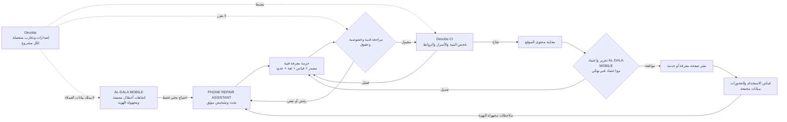
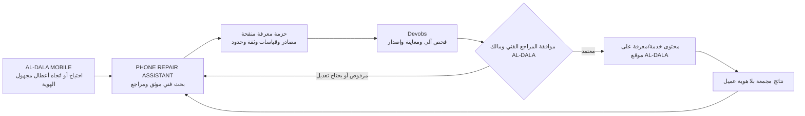

# وثيقة تنفيذية: نموذج تشغيل وتكامل المشاريع الثلاثة

**الإصدار:** 1.0  
**التاريخ:** 14 أكتوبر 2026  
**الحالة:** نموذج تنفيذي مستهدف للمراجعة والتطبيق المرحلي

> تستند هذه الوثيقة إلى وصف مالك المشاريع في المحادثة. وهي تميّز بين العلاقة المستهدفة وبين التكاملات التي ثبت وجودها فعليًا؛ لا تفترض أن المواقع أو واجهات البرمجة أو خطوط النشر مترابطة اليوم.

## 1. الملخص التنفيذي

تعمل المشاريع الثلاثة كمنظومة متعاونة، مع بقاء لكل مشروع منتجه وبياناته وقراراته:

- **AL-DALA MOBILE** هو النشاط التجاري وواجهة العميل: استقبال طلبات البيع والصيانة، تقديم الخدمات، وإدارة محتوى الموقع والعلاقة مع العميل.
- **PHONE REPAIR ASSISTANT** هو مرجع المعرفة والتشخيص الفني: يحول الأدلة والقياسات والمصادر إلى إجراءات تشخيص قابلة للمراجعة وإعادة الاستخدام.
- **Devobs** هو طبقة هندسة البرمجيات والأتمتة: يدير المستودعات، والتحقق الآلي، والأمن، وتجارب التطوير، وعمليات الإصدار والنشر المصرح بها.

تنتقل المعرفة من PHONE REPAIR ASSISTANT إلى AL-DALA MOBILE عبر **حزمة معرفة فنية منقحة ومراجعة بشريًا**. ويستطيع Devobs التحقق من بنية هذه الحزمة ومن تغييرات الموقع وتشغيل بيئات المعاينة؛ لكنه لا يقرر صحة التشخيص ولا يملك المحتوى التجاري أو بيانات العملاء. لا يُنشر أي نص تشخيصي تلقائيًا لمجرد أن فحص CI نجح.

## 2. أهداف المشاريع وحدود ملكيتها

| المشروع | الهدف الأساسي | مالك القرار | ما يملكه | ما لا يملكه |
|---|---|---|---|---|
| AL-DALA MOBILE | تشغيل النشاط التجاري وتحسين خدمة العميل والتحويل إلى زيارة أو حجز | مسؤول النشاط/الموقع | العلامة التجارية، الأسعار والخدمات، صفحات الموقع، طلبات العملاء وموافقاتهم | قواعد التشخيص الفنية الأصلية، مفاتيح CI/CD المشتركة، سياسة أدوات المطورين |
| PHONE REPAIR ASSISTANT | تطوير منهج تشخيص الهواتف بالاستناد إلى المصدر والقياس ودرجة الثقة | المراجع الفني | نماذج جمع الأدلة، إجراءات التشخيص، المراجع الفنية، الحالات التعليمية المنقحة | بيانات هوية العملاء، نشر محتوى الموقع مباشرة، أسرار النشر أو سجلات المبيعات |
| Devobs | أتمتة بناء المشاريع واختبارها وتأمينها ونشرها وفق موافقات واضحة | مسؤول DevOps/المستودع | المستودعات وسير العمل والبيئات وسجلات البناء وسياسات الفروع والنشر | اعتماد عطل فني، تقرير حالة عميل، صياغة ادعاء تسويقي، أو قرار قبول إصلاح |

### مصادر الحقيقة

1. بيانات الطلبات والعميل وموافقات الإصلاح: نظام AL-DALA MOBILE التجاري.
2. المعرفة الفنية والإجراءات ومراجعها: PHONE REPAIR ASSISTANT.
3. تعريف البناء والاختبارات وبيئات النشر: مستودع المشروع المعني ضمن Devobs.
4. النص المنشور للعميل: نظام إدارة محتوى أو مستودع موقع AL-DALA MOBILE، بعد موافقة مالك المحتوى والمراجع الفني.

لا تنشأ قاعدة بيانات مشتركة لمجرد أن المشاريع متصلة تشغيليًا. إذا احتاجت المنظومة لاحقًا إلى واجهة تكامل، تُعرّف كعقد محدود ومراجع قبل التنفيذ.

## 3. العلاقة الحالية والهدف التشغيلي

العلاقة الحالية هي تقسيم أدوار واتجاه تعاون. لا يوجد في المعلومات المتاحة ما يثبت وجود مزامنة مباشرة بين الأنظمة الثلاثة أو نشر آلي قائم من PHONE REPAIR ASSISTANT إلى موقع AL-DALA MOBILE.

الهدف التنفيذي هو إنشاء مسار تسليم مضبوط:

1. تُجمع احتياجات التشخيص من الخبرة الفنية أو من اتجاهات أعطال مجمعة ومجهولة الهوية من النشاط التجاري.
2. يطوّر PHONE REPAIR ASSISTANT إجراءً فنيًا ويثبت مصدره وحدوده ودرجة الثقة.
3. تُحوّل النتيجة إلى حزمة معرفة لا تتضمن بيانات عميل أو جهاز بعينه.
4. يراجع Devobs سلامة الملف والتغييرات البرمجية والبيانات الحساسة، ثم ينشئ معاينة للموقع عند الحاجة.
5. يراجع الفني صحة المعلومة، ويراجع مسؤول AL-DALA MOBILE ملاءمتها للعميل والعلامة التجارية.
6. يقرر مسؤول الموقع النشر. تُراقب النتائج ثم تعاد الملاحظات إلى قائمة تطوير PHONE REPAIR ASSISTANT.

## 4. مسار انتقال نتائج التشخيص إلى محتوى وخدمات الموقع

### 4.1 حزمة المعرفة الفنية

يُسلّم PHONE REPAIR ASSISTANT مخرجاته في ملف Markdown أو JSON منظم، بإصدار واضح. يتضمن الحد الأدنى:

- معرّفًا ثابتًا للموضوع، وتاريخ المراجعة، وإصدار الحزمة.
- الشركة/العائلة والطراز أو مراجعة اللوحة عند ثبوتها؛ وإلا تُسجل «غير مؤكدة».
- وصف العَرَض بصياغة عامة خالية من بيانات العميل.
- الأدلة والقياسات مع الوحدة وظروف القياس ونقطة القياس ومصدر المرجع.
- فصل الملاحظة المؤكدة عن الاستنتاج والاحتمال والمجهول.
- حدود الإجراء ومخاطر القياس والاختبار الآمن التالي.
- روابط أو بيانات المصادر وحقوق استخدامها.
- اسم/دور المراجع الفني، وحالة المراجعة، وتاريخ المراجعة التالية.
- حقل يحدد الجمهور: داخلي للفنيين أو صالح للتحرير للجمهور.

لا تُضمّن الحزمة اسم العميل أو هاتفه أو رقم IMEI/serial كاملًا أو صورًا تحتوي بيانات تعريفية أو سجلات أدوات خامًا قبل تنقيحها. لا تستخدم حالة عميل فردية كمقال عام إلا بعد تحويلها إلى مثال مجهول الهوية ومراجع.

### 4.2 بوابات التحويل والنشر

| البوابة | المسؤول | القرار المطلوب | شرط المرور |
|---|---|---|---|
| مراجعة الدليل | مراجع PHONE REPAIR ASSISTANT | هل الاستنتاج مدعوم بالمصدر والقياس؟ | لا ادعاء بقيمة أو مكوّن بلا مرجع؛ النقص والاحتمال معلنان |
| مراجعة الخصوصية والحقوق | ممثل المشروع المصدر/مسؤول الخصوصية | هل أزيلت بيانات العميل وهل يحق استخدام المادة؟ | لا بيانات تعريفية أو سرية؛ مصدر قابل للاستخدام |
| فحص الملف | Devobs CI | هل البنية سليمة ولا توجد أسرار أو ملفات غير مسموحة؟ | نجاح فحوص المخطط والخصوصية والروابط والفحوص البرمجية اللازمة |
| التحرير التجاري | محرر AL-DALA MOBILE | هل تحولت المعلومة إلى شرح مفهوم وخدمة مناسبة؟ | لا ضمان نتيجة أو سعر أو مدة غير معتمدة؛ صياغة متوافقة مع العلامة |
| اعتماد النشر | مالك الموقع + المراجع الفني | هل يمكن نشر النسخة المحددة؟ | موافقتان مسجلتان وإصدار معروف وخطة رجوع |
| المتابعة | مالك الموقع ومالك المعرفة | هل المحتوى مفيد وما الذي يحتاج تحديثًا؟ | قياس تفاعل مجمع، ومسار لتصحيح/سحب المحتوى |

### 4.3 تحويل المعرفة إلى خدمة

الموقع لا يشخّص عطلًا نهائيًا اعتمادًا على صفحة محتوى. يمكنه تقديم:

- صفحات خدمة توضح أنواع الفحص، وما يتوقعه العميل من الورشة، ومعلومات الحجز والتواصل.
- دليل أولي يطلب وصف العَرَض والطراز دون طلب PIN أو كلمة مرور أو IMEI كامل.
- نموذج حجز أو طلب فحص يرسل البيانات إلى AL-DALA MOBILE وفق سياسة الخصوصية والموافقة.
- إرشادات عامة آمنة تساعد العميل على وصف الحالة؛ ولا توجهه إلى فتح الجهاز أو إجراء قياسات خطرة.

تبقى نتيجة الفحص داخل AL-DALA MOBILE مرتبطة بموافقة العميل. ويمكن أن تغذي تطوير المعرفة لاحقًا بعد تجميعها وتنقيحها ومراجعتها، لا عبر نسخ الطلب الخام تلقائيًا.

## 5. دور Devobs في الأتمتة والتجارب

يتعامل Devobs مع كل مشروع كمستودع أو وحدة نشر مستقلة. ويمكن أن يدير:

- فحوص البناء والأنماط والروابط والتحقق من مخطط حزمة المعرفة.
- فحص الأسرار والاعتماديات وتكوينات CI/CD وملفات البنية التحتية.
- إنشاء بيئة معاينة لكل تغيير محتوى/موقع، مع عنوان غير عام عند الحاجة.
- تشغيل تجارب AI على بيانات اصطناعية أو مجهولة الهوية، وقياس الجودة والتكلفة وزمن الاستجابة.
- إصدار نسخة مؤرخة، وسجل تغيير، وفحص رجوع قبل الإنتاج.
- نشرًا محميًا يتطلب مراجعة PR وموافقة مالك البيئة، ولا يعمل افتراضيًا قبل استكمال إعداد الموارد والأسرار.

نجاح CI يعني أن الشروط الآلية المحددة اجتازت الفحص؛ ولا يعني أن التشخيص صحيح أو أن المحتوى موافق عليه للنشر. اعتماد المعرفة فني، واعتماد المحتوى تجاري، واعتماد النشر تشغيلي.

ويفصل **ملحق أ** خارطة قدرات DevOps المعزز بالذكاء الاصطناعي وتسلسل إدخالها في Devobs. ورود أي مجال في الخارطة يعني أنه هدف قابل للتقييم، ولا يثبت أنه مطبق حاليًا.

## 6. خريطة التدفق

## 7. مصفوفة المسؤوليات

| النشاط | PHONE REPAIR ASSISTANT | AL-DALA MOBILE | Devobs |
|---|---|---|---|
| تعريف منهج التشخيص ومراجعة الدليل | مسؤول/معتمد | مستشار عند الحاجة | لا يقرر |
| جمع بيانات العميل وموافقته | لا يملكها | مسؤول/معتمد | لا يصل إليها |
| كتابة النص الموجه للعميل | يقدم المصدر الفني | مسؤول/معتمد | يجهز المعاينة آليًا |
| فحص الخصوصية والسرية آليًا | يلتزم بالتنقية | يراجع الاستخدام التجاري | ينفذ الفحوص |
| إدارة المستودعات والـ CI/CD | يملك مستودعه وإصداره | يملك مستودعه/موقعه | يدير الأتمتة والسياسات |
| قرار النشر للإنتاج | لا يقرره | مالك الموقع يقرره | ينفذه بعد الموافقات |
| تحليل أثر الخدمة | لا يقرأ بيانات التعريف | يملك تحليلات النشاط | يوفّر القياس التقني فقط |

## 8. الحدود العملية التي تمنع تداخل المشاريع

1. **حدود المستودعات:** لكل مشروع مستودع ومالكون ومراجعاته. لا تُنسخ ملفات مشروع إلى آخر لمجرد سهولة البناء؛ تعبر المعرفة فقط بحزمة معلومة الإصدار.
2. **حدود البيانات:** سجلات العميل والبيع والإصلاح تبقى لدى AL-DALA MOBILE. لا تُرفع إلى المستودعات أو سجلات CI أو أدوات AI. لا تستخدم بيانات حقيقية في التجارب.
3. **حدود الأسرار:** مفاتيح OpenAI والنشر تحفظ في مدير أسرار، وتُحقن في بيئة الخادم أو CI المناسبة فقط. لا تتضمن حزم المعرفة أو ملفات الواجهة أي قيمة سرية. لكل بيئة ومشروع أسراره وصلاحياته.
4. **حدود النشر:** لا نشر مباشر من PHONE REPAIR ASSISTANT إلى الموقع. لا تمنح Devobs صلاحية تحرير بيانات العملاء. لا يُنشر إنتاجًا بلا موافقة مالك الموقع والمراجع الفني.
5. **حدود الثقة:** مخرجات النموذج أو مسودة المحتوى ليست دليلًا بذاتها. يجب إظهار المصدر والقياس والشك، ويظل الفني مسؤولًا عن قرار الإصلاح.
6. **حدود الأمان الفني:** لا ينشر مسارًا لتجاوز FRP/KG/RMM أو تغيير IMEI أو استنساخ الشهادات، ولا تعليمات قياس قد تضر الجهاز دون إثبات المصدر وشروط السلامة.
7. **حدود الملكية الفكرية:** لا تُرفع مخططات أو Boardview أو أدلة مصنع إلى الموقع أو المستودعات العامة ما لم تكن حقوق الاستخدام واضحة.
8. **حدود الفشل:** إذا تعطل CI أو التكامل، تتوقف الحزمة عند آخر إصدار معتمد. لا يُسمح للنظام بتخمين المحتوى أو تجاوز المراجعات يدويًا عبر مفاتيح نشر عامة.

## 9. خطة التنفيذ المرحلية

### المرحلة 0 — تثبيت الحدود والملكية

- تسمية مالك فني ومحرر/مالك موقع ومسؤول أتمتة.
- حصر المستودعات الحالية والبيئات ومصادر الحقيقة؛ وتسجيل ما هو قائم وما هو مقترح.
- اعتماد مصفوفة البيانات والأسرار والنشر أعلاه.

**القبول:** لا توجد صلاحية مشتركة غير مبررة، وكل أصل له مالك ومكان رسمي.

### المرحلة 1 — عقد حزمة المعرفة

- إعداد قالب Markdown أو JSON بإصدار `1.0` يتضمن حقول القسم 4.1.
- إنشاء مثال تدريبي اصطناعي أو حالة مجهولة الهوية ومراجعتها فنيًا.
- تثبيت علامات `CONFIRMED / INFERENCE / POSSIBLE / UNKNOWN` وسياسة المصدر.

**القبول:** يمكن لفني آخر إعادة فهم الحالة دون اسم العميل أو افتراضات غير موثقة.

### المرحلة 2 — تدفق تحريري يدوي مضبوط

- تسليم الحزمة إلى مستودع/مساحة محتوى AL-DALA MOBILE عبر PR أو ملف إصدار.
- كتابة نسخة الجمهور، مع رابط مرجعي داخلي للحزمة الفنية وإصدارها.
- الحصول على الاعتماد الفني والتجاري قبل النشر.

**القبول:** لا يوجد نشر تلقائي، وتظهر المراجعات والتاريخ والمالك بوضوح.

### المرحلة 3 — أتمتة Devobs

- بناء CI يفحص تنسيق الحزمة والحقول الإلزامية والروابط ووجود بيانات تعريفية أو أسرار.
- إعداد معاينة staging منفصلة عن الإنتاج، ومراجعة PR وحماية البيئة.
- تشغيل تجارب AI ببيانات اصطناعية، مع تسجيل النموذج والإعدادات والتكلفة والنتيجة دون بيانات شخصية.

**القبول:** فشل الفحص يمنع الدمج/النشر؛ ونجاحه لا يتجاوز الموافقة البشرية.

### المرحلة 4 — نشر الموقع وقياس الأثر

- نشر الحزمة التحريرية المعتمدة إلى الموقع، يدويًا في البداية أو عبر نشر محمي.
- إضافة روابط حجز/خدمة مناسبة دون ادعاء تشخيص نهائي عن بعد.
- قياس الزيارات والتحويلات وأخطاء الصفحة ببيانات مجمعة، ثم تحويل الأسئلة المتكررة إلى backlog فني مجهول الهوية.

**القبول:** يوجد إصدار قابل للرجوع، ومؤشر تحديث، ومالك يزيل أو يصحح المادة عند اكتشاف خطأ.

### المرحلة 5 — توسعة اختيارية

بعد إثبات التدفق اليدوي فقط، يمكن تقييم واجهة API للقراءة من محتوى معتمد أو مزامنة مؤتمتة. يجب أن تكون أحادية الاتجاه، محدودة الحقول، قابلة للتدقيق، ومحمية بمصادقة وصلاحيات. لا تُربط قاعدة بيانات الطلبات بمساعد المعرفة مباشرة.

## 10. مقاييس النجاح

| المشروع | المقاييس المقترحة |
|---|---|
| PHONE REPAIR ASSISTANT | نسبة الحالات ذات مصدر وموديل مطابقين؛ اكتمال شروط القياس؛ معدل تصحيح المراجعة؛ عمر المعلومة قبل إعادة التحقق؛ عدد الاستنتاجات غير المدعومة |
| AL-DALA MOBILE | حداثة صفحات الخدمة؛ نسبة زيارة الصفحة إلى استفسار/حجز؛ وضوح توقعات العميل؛ معدل الشكاوى أو التصحيحات المتعلقة بالمحتوى |
| Devobs | نجاح CI؛ زمن المعاينة؛ عدد النشرات التي رجعت؛ زمن استعادة الإصدار؛ فشل فحص الأسرار أو الثغرات؛ قابلية إعادة التجربة |
| المنظومة | الزمن من اعتماد الدليل إلى النشر؛ نسبة حزم المحتوى التي اجتازت المراجعة من أول مرة؛ عدد حوادث تسرب أو تداخل البيانات (المستهدف: صفر) |

تُراجع الأرقام دوريًا. لا تُستخدم بيانات تقيس عميلًا فرديًا لتدريب مساعد أو نشر حالة من دون موافقة ومراجعة الخصوصية.

## 11. شروط الجاهزية للإنتاج

لا تُعلن المنظومة جاهزة تجاريًا حتى تتوفر جميع العناصر التالية:

- تسجيل دخول وصلاحيات مناسبة لكل موظف وورشة، مع فصل بيئة التطوير عن الإنتاج.
- سياسة خصوصية وموافقة واضحة للمحتوى المرسل إلى مزود AI، وتقليل البيانات والاحتفاظ بها.
- أسرار في مخزن معتمد، وصلاحيات أقل ما يمكن، وإجراء تدوير للمفاتيح.
- نسخ احتياطي واستعادة واختبار رجوع، مع سجل تغييرات للمحتوى والإصدارات.
- مراجعة أمنية لواجهات API وCI/CD وإعدادات الاستضافة وبيانات الموقع.
- مراجعة فنية/تحريرية مسجلة، ومالك مسؤول عن كل صفحة خدمة وكل حزمة معرفة.
- خطة استجابة لتصحيح محتوى ضار أو غير دقيق وإيقاف التكامل عند الطوارئ.

## 12. القرار التنفيذي التالي

ابدأ بالمرحلة 0 ثم جهّز قالب حزمة معرفة واحدًا وحالة تجريبية منزوعة الهوية. انقلها يدويًا إلى بيئة معاينة AL-DALA MOBILE، واطلب اعتماد المراجع الفني ومالك الموقع. بعد نجاح دورة واحدة كاملة، أضف فحوص Devobs الآلية. بهذه الطريقة تُختبر العلاقة بين المشاريع عمليًا من دون دمج الملكيات أو نقل بيانات لا حاجة لها.

## 13. الخريطة النهائية وحدود الفصل

**حدود التشغيل التي لا يجوز تجاوزها:**

- لكل مشروع مستودعه ومالك قراره ومصدر بياناته؛ لا قاعدة بيانات مشتركة ولا صلاحيات عامة بين المشاريع.
- لا تغادر بيانات العميل الخام نظام AL-DALA MOBILE، ولا تدخل سجلات CI أو المستودعات أو التجارب.
- لا تنتقل إلى الموقع إلا حزمة فنية منقحة ومعتمدة؛ فحوص Devobs لا تستبدل المراجعة الفنية أو التحريرية.
- لا نشر تلقائي من مساعد التشخيص، ولا قرار إصلاح أو ضمان آلي بناءً على مخرجات AI.
- أسرار كل مشروع وبيئة منفصلة ومخزنة خارج الشيفرة؛ لا يصل المتصفح إلى مفاتيح الخادم أو النشر.
- تعود من الموقع إلى PHONE REPAIR ASSISTANT ملاحظات استخدام مجمعة ومجهولة الهوية فقط.

## ملحق أ — خارطة قدرات DevOps المعزز بالذكاء الاصطناعي في Devobs

هذه خارطة مرجعية تجمع المجالات التي اقترحها مالك المشروع مع متطلبات الموثوقية وسلسلة التوريد وتشغيل الذكاء الاصطناعي. تُختار منها القدرات بحسب حاجة كل خدمة؛ ولا يعني إدراج أداة مثل Kubernetes أو Prometheus اعتمادها قبل وجود مبرر تشغيلي.

### أ.1 مجالات القدرات

| المجال | النطاق العملي في Devobs |
|---|---|
| CI/CD | بناء واختبار وتغليف وإصدار متكرر، مع بوابات موافقة منفصلة قبل الإنتاج. |
| الحاويات | صور Docker قابلة لإعادة البناء، صغيرة ومحددة الإصدارات، مع فحص قبل النشر. |
| تنسيق الحاويات | Kubernetes عند الحاجة إلى تنسيق أحمال متعددة أو توسع وتشغيل يتطلبانه؛ لا يُضاف لمجرد الحداثة. |
| هندسة المنصات | مسارات خدمة ذاتية وقوالب آمنة وموحدة للمطورين، مع صلاحيات وحدود تكلفة افتراضية. |
| IaC | تعريف موارد السحابة من الشيفرة عبر Terraform أو بديل مناسب، مع مراجعة خطة التغيير قبل تطبيقها. |
| إدارة التكوين | استخدام Ansible لتكوين الأنظمة بصورة قابلة للتكرار، مع فصل بيانات البيئة والأسرار عن Playbooks. |
| السياسات ككود | فرض قواعد الأمن والامتثال على إعدادات البنية والصور وسير العمل آليًا قبل الدمج أو التطبيق. |
| الاختبارات المؤتمتة | اختبارات الوحدة والتكامل والعقد والواجهة والأداء والأمن بحسب مخاطر كل مكوّن. |
| DevSecOps | فحص الشيفرة والتبعيات والحاويات وIaC والأسرار، وإصلاح الثغرات وفق أولوية ومهلة معلنتين. |
| GitOps | اعتبار المستودع مصدر الحالة المرغوبة للبيئة، مع مزامنة محمية وسجل واضح للتغييرات والرجوع. |
| FinOps | توزيع تكلفة السحابة حسب الخدمة والبيئة، وضبط ميزانيات وتنبيهات ومراجعة موارد غير مستخدمة. |
| LLM/AI FinOps | قياس تكلفة الرموز والنموذج والأدوات والحوسبة لكل مهمة، مع حدود إنفاق وتنبيه وإيقاف آمن. |
| المقاييس والتنبيهات | مؤشرات الخدمة والموارد والتنبيه القابل للتصرف، باستخدام Prometheus/Grafana أو بدائل مناسبة. |
| السجلات المركزية | سجلات منظمة ومحدودة الاحتفاظ، مع إخفاء الأسرار والبيانات الشخصية قبل التخزين. |
| AIOps | تحليل شذوذات الأعطال ومساندة الفرز والتنبؤ؛ تبدأ التوصية بالقراءة، ولا تنفذ إصلاحًا حساسًا ذاتيًا. |
| SRE والمرونة | تعريف SLI/SLO وميزانية الأخطاء، وإدارة الحوادث والمراجعات اللاحقة، واختبار النسخ الاحتياطي والتعافي. |
| هوية وسلسلة التوريد | أقل الصلاحيات، إدارة الأسرار، فحص التبعيات، SBOM، توقيع الأثر والتحقق من مصدره وسلامته. |
| LLMOps وحوكمة الوكلاء | إصدار النماذج والتعليمات والأدوات، تقييم الجودة والانحراف، عزل الأسرار، مقاومة حقن التعليمات، وتأكيد بشري للأفعال الحساسة. |

### أ.2 ترتيب التطبيق المقترح

| المرحلة | ما يُبنى | دليل القبول قبل الانتقال |
|---|---|---|
| 1. أساس آمن | صلاحيات المستودع والبيئات، أسرار خارج الشيفرة، اختبارات CI، فحوص التبعيات والأسرار، وموافقة بشرية للإنتاج. | فشل الفحوص يمنع الدمج أو الإصدار المحمي؛ لا يملك أي workflow صلاحيات أوسع من حاجته. |
| 2. بناء قابل للتكرار | حاويات عند الحاجة، Terraform لموارد السحابة، Ansible للتكوين، وسياسات ككود. | يمكن إعادة إنشاء بيئة اختبار من ملفات معروفة، وتُراجع خطة التغيير قبل التنفيذ. |
| 3. تشغيل موثوق | GitOps عند ملاءمته، سجلات ومقاييس وتنبيهات، SLO، نسخ احتياطي واختبار استعادة، ومراجعة تكلفة دورية. | توجد لوحة تشغيل وتنبيه مجرّب وإجراء رجوع واستعادة موثق لكل خدمة حرجة. |
| 4. ذكاء اصطناعي مضبوط | سجل إصدارات للنموذج والتعليمات والأدوات، مجموعة تقييم ثابتة، قياس التكلفة، واختبارات إساءة الاستخدام وMCP عند وجوده. | لا تصل بيانات حقيقية إلى التجارب بلا موافقة؛ لا ينفذ الوكيل كتابة أو نشرًا أو إجراءً ماليًا دون موافقة مناسبة. |
| 5. منصة ومهارات | قوالب ومسارات ذاتية الخدمة، ثم تدريب CBTA قائم على مهام عملية وأدلة أداء. | يستطيع عضو الفريق تنفيذ المهمة بأمان في بيئة اختبار، ويعرف حدود صلاحياته ومسار التصعيد. |

### أ.3 ضوابط التشغيل

- تُسجل لكل قدرة حالة منفصلة: **مقترحة، قيد التجربة، معتمدة، أو مطبقة**؛ ولا تُعرض التجربة على أنها جاهزة للإنتاج.
- تبدأ AIOps وLLMOps بوضع القراءة والتوصية. أي معالجة ذاتية يجب أن تكون منخفضة المخاطر، قابلة للعكس، محدودة الصلاحيات، ومختبرة في بيئة غير إنتاجية قبل النظر في اعتمادها.
- تعتمد تجارب الوكلاء على بيانات اصطناعية أو منقحة، وتُختبر ضد حقن التعليمات، وتسميم نتائج الأدوات، وتسريب الأسرار، وتجاوز حدود الصلاحيات.
- يُربط كل تغيير في البنية أو السياسة أو الوكيل بمالك ومراجع وسجل إصدار وقياس نجاح وخطة تراجع.
- لا يُفترض أن كل مشروع يحتاج جميع هذه الأدوات؛ يختار Devobs أصغر مجموعة تحقق متطلبات الخدمة بأمان وكلفة قابلة للقياس.
