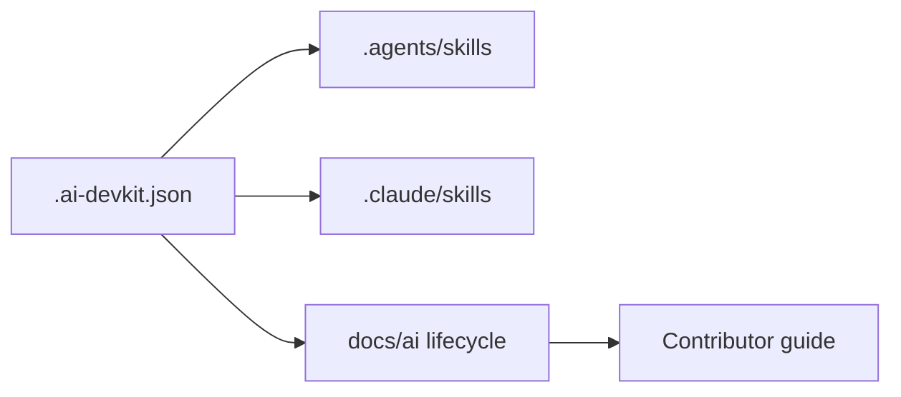

# التصميم والمعمارية

## نظرة عامة

يكون `.ai-devkit.json` مصدر الإعداد الموحّد. يحمّل Codex المهارات من `.agents/skills/`، ويحملها Claude Code من `.claude/skills/`. توثق ملفات `docs/ai/` مراحل دورة العمل، ويشرح `docs/AI_DEVKIT.md` الإعداد للمساهمين.

## قرارات التصميم

- تثبيت تعريفات المهارات بنسخ محلية (`mode: copy`) حتى لا تعتمد نسخة المستودع على مسار جهاز منشئها.
- اختيار المهارات المتعلقة بدورة التطوير والجودة فقط؛ عدم إضافة موصلات رسائل أو أسرار.
- إبقاء جميع مراحل التوثيق مفعلة لمختلف أنواع الأعمال، مع اعتبار وثائق كل ميزة متناسبة مع نطاقها.
- عدم إدخال تبعية AI DevKit في مسار البناء أو النشر للموقع.
- إرفاق إشعار ورخصة المصدر المفتوح للملفات المنسوخة.

## الأمن والقيود

المهارات تعليمات يقرأها وكيل البرمجة؛ لا تحتوي هذه التهيئة مفاتيح أو بيانات اعتماد ولا تشغّل نشرًا تلقائيًا. تبقى مراجعة الشيفرة والموافقة على النشر مسؤولية المساهمين.
