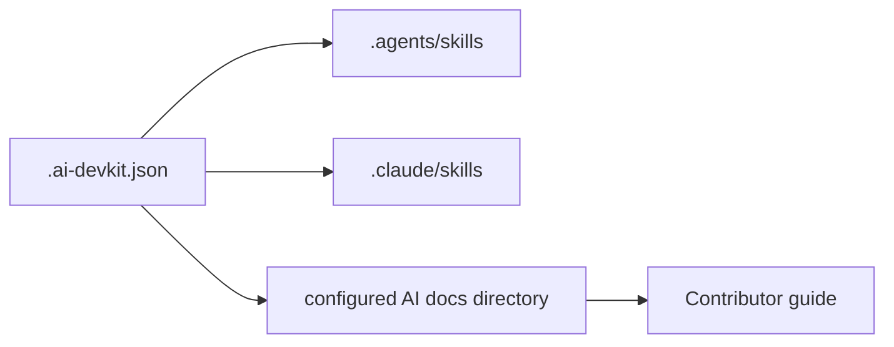

# التصميم والمعمارية

## نظرة عامة

يكون `.ai-devkit.json` مصدر الإعداد الموحّد. يحمّل Codex المهارات من `.agents/skills/`، ويحملها Claude Code من `.claude/skills/`. توثق ملفات `$DOCS_DIR/` مراحل دورة العمل، حيث يأتي `$DOCS_DIR` من `paths.docs` أو يكون `docs/ai` افتراضيًا. يشرح `docs/AI_DEVKIT.md` الإعداد للمساهمين.

## قرارات التصميم

- تثبيت تعريفات المهارات بنسخ محلية (`mode: copy`) حتى لا تعتمد نسخة المستودع على مسار جهاز منشئها.
- اختيار المهارات المتعلقة بدورة التطوير والجودة فقط؛ عدم إضافة موصلات رسائل أو أسرار.
- إبقاء جميع مراحل التوثيق مفعلة لمختلف أنواع الأعمال، مع اعتبار وثائق كل ميزة متناسبة مع نطاقها.
- عدم إدخال تبعية AI DevKit في مسار البناء أو النشر للموقع.
- إرفاق إشعار ورخصة المصدر المفتوح للملفات المنسوخة.
- حفظ حالات مراجعة المتطلبات والتصميم والتنفيذ والاختبار والمراجعة في قائمة داخل مستند التنفيذ، حتى يستطيع كاشف الحالة استئناف أول مرحلة غير مكتملة.
- اشتراط تسجيل اكتمال المرحلة 4 بعد مراجعة المتطلبات والتصميم قبل تنفيذ الخطة، حتى لا يتجاوز وجود خطة قديمة المراجعات.
- مطابقة كل مستند مع مجلد مرحلته نسبةً إلى `paths.docs` المهيأ، لا نسبةً إلى أسماء المراحل التي قد تظهر في أجزاء أخرى من المسار.
- استخدام أسماء المهارات المتوافقة مع مخطط CLI في قالب الإعداد.
- استخدام ملف Git المحلي `info/exclude` لإخفاء مجلد worktrees أثناء الإعداد دون تعديل checkout المصدر.
- استئناف فرع الميزة من مسار worktree المسجل في Git، حتى إذا كان خارج مجلد `.worktrees` الافتراضي.
- إبقاء كتابة الذاكرة ضمن نطاق المستودع، وتعطيل الاستدعاء التلقائي لمهارة Claude التي قد تتداخل مع سير عمل تحليل الحوادث.

## الأمن والقيود

المهارات تعليمات يقرأها وكيل البرمجة؛ لا تحتوي هذه التهيئة مفاتيح أو بيانات اعتماد ولا تشغّل نشرًا تلقائيًا. تبقى مراجعة الشيفرة والموافقة على النشر مسؤولية المساهمين.

لا توجد واجهات API أو نماذج بيانات خاصة بهذا الإعداد؛ فالمخرجات إعدادات ومستندات وسكربت محلي لاستئناف دورة التطوير.
