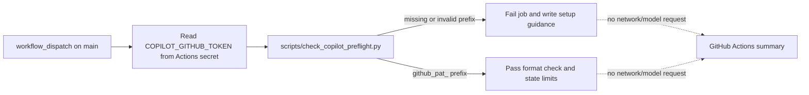

# Design

## Flow

## Components

- `scripts/check_copilot_preflight.py` evaluates only presence and the `github_pat_` prefix, creates safe remediation text, and writes it to `GITHUB_STEP_SUMMARY`.
- `ai-provider-preflight.yml` checks out the current main revision using the already approved SHA-pinned checkout action and runs the checker with the secret in its environment.
- `tests/test_ai_provider_preflight.py` verifies missing, malformed, and accepted-format outcomes and asserts that secret values never appear in output.

## Design decisions

- Keep the checker dependency-free and separate from GitHub API/network calls so all behavior can be tested locally.
- Fail closed for an absent or malformed secret, but explain the exact manual fix in the job summary.
- Mention that `POLICY_AUDIT_TOKEN` is a different read-only repository audit token and cannot satisfy the Copilot credential requirement.
- Explicitly state that prefix acceptance does not verify `Copilot Requests: Read`, quota, model access, or inference. A successful preflight must not imply those checks passed.
- Do not add token decoding, logging, shell interpolation, or model inference.

## Security and reliability

The secret is consumed only as an environment variable. The checker never writes it, includes it in diagnostics, or makes an outbound request. The job keeps `contents: read`; it receives no write permissions. Checkout remains pinned by commit SHA.
