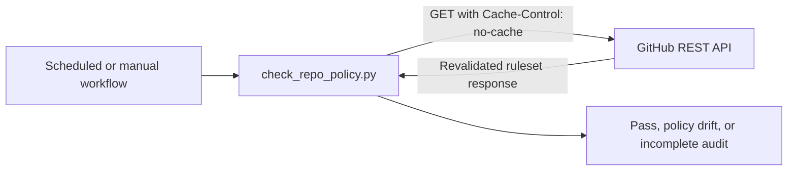

# Reliable Repository Policy API Reads

## Architecture Overview

The existing audit client remains the sole API boundary. This follow-up adds a cache revalidation request directive to each fixed HTTPS GET. The workflow continues to provide the existing optional read-only token; policy checks and output stay unchanged.

## Data Models and API Contract

No domain data or endpoint changes. `get_json` sends `Accept`, `User-Agent`, GitHub API version, and `Cache-Control: no-cache`; it adds a bearer Authorization header only when the existing read-only token is supplied, and performs no writes. All API responses continue through the current schema checks.

## Component Breakdown

- `scripts/check_repo_policy.py`: request-level cache directive.
- `tests/test_check_repo_policy.py`: assert the directive on the constructed public API request.
- Lifecycle documentation: record the regression, fix, and hosted verification.

## Design Decisions

- Use HTTP cache revalidation on every request. This addresses the observed 60-second cache lifetime alongside the existing optional read-only token, without retries or additional dependencies.
- Keep missing or malformed ruleset fields fail-visible. Interpreting an absent bypass list as empty could conceal a policy that was not actually inspected.
- Do not add a retry loop; the request directive is the minimal correction and existing timeout/error handling remains bounded.

## Non-Functional Requirements

- Read-only and least-privilege: unchanged GET-only behavior; authenticated runs use the existing token with Administration: read.
- Runtime: one request per existing endpoint, with the current 15-second timeout.
- Reliability: a stale cache must revalidate before the audit evaluates policy.
