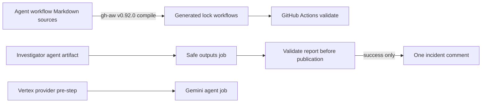

# System Design & Architecture

## Architecture Overview

- Markdown remains the editable source for agentic workflows.
- The versioned `gh-aw` compiler injects and pins its runtime actions into `.lock.yml` files.
- The safe-output job downloads the agent artifact, checks its shape and required report markers, then proceeds to its publisher only if the validation step succeeds.
- The validator does not write data or read a GitHub credential; the checkout uses `persist-credentials: false`. The existing safe-output policy still limits the target and allows at most one comment.
- The Vertex provider-normalization step is configured as an `agent` pre-step, so `steps.vertex_provider.outputs.provider_resource` is available in the same job as the Gemini CLI invocation.

## Data Models

The validator accepts a JSON object with exactly one `items` entry. That entry must have `type: add_comment`, a string body, exactly one leading `<!-- devobs-investigation:v1 -->` marker, and the `## AI Incident Investigation` heading. It writes no data and does not normalize the agent output.

## API Design

No application API or external AI API is called. The validator consumes the `agent_output.json` workflow artifact. The GitHub Actions artifact download action and checkout action use immutable commit SHAs.

## Component Breakdown

- `scripts/validate_incident_report.cjs`: deterministic output-shape and report-marker validation.
- `incident-investigator.md` and `incident-investigator-claude.md`: validation step ordered between artifact download and safe-output publication.
- `incident-investigator-vertex.md`: provider normalization runs in the agent job that consumes its output.
- Five generated `.lock.yml` files and `.github/aw/actions-lock.json`: compiled with `gh-aw` v0.92.0.
- `docs/CI.md`: source-of-truth and regeneration procedure.

## Design Decisions

- Validate the downloaded agent artifact in the safe-output job before its publisher instead of reading or rewriting protected output files inside agent `post-steps`.
- Fail closed when a report is malformed; do not mutate read-only artifacts or attempt a repair that may not reach the publisher's canonical input.
- Keep workflow step outputs inside the job that consumes them; this protects the Vertex provider reference from a cross-job expression error.
- Refresh only the five current agentic workflow sources; keep the AWS Dependabot updates separate.

## Non-Functional Requirements

- Least privilege: validator code does not persist checkout credentials or publish directly; the dedicated publisher remains bounded to one comment.
- Reliability: a nonzero validator step stops the later safe-output processing step in the same job.
- Cost: no model call, cloud resource, new package, or paid service is introduced.
