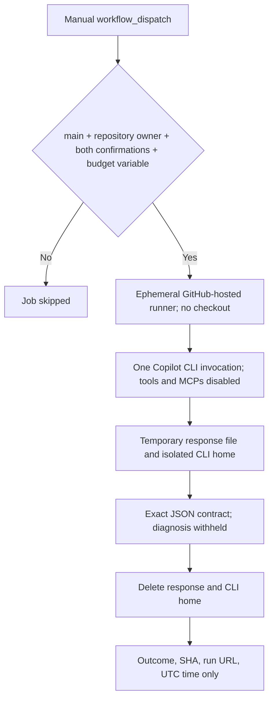

# System Design & Architecture

## Architecture Overview

## Component Breakdown

- `.github/workflows/copilot-inference-smoke.yml`: manual trigger, owner and quota attestations, budget gate, no checkout, isolated CLI call, validator, cleanup, and minimal run receipt.
- GitHub-hosted `ubuntu-24.04` runner: disposable execution environment. The only action is `actions/setup-node`, pinned to a full commit SHA.
- `@github/copilot` CLI: exact package version `1.0.102`; explicit model `gpt-5.6-luna`; no autopilot or share/export option.
- Inline Python validator: accepts only an object with exactly two keys, status `ok`, and a non-empty diagnosis of at most 25 whitespace-delimited words.

## Data Flow and Retention

- The fixed prompt is supplied through a step environment variable; it is not placed in the shell command text.
- Copilot stdout/stderr are redirected to a mode-0600 temporary file. The validator prints only a fixed status message.
- `COPILOT_HOME` is isolated in the runner temp area with `remote: off`; client-side telemetry is disabled for the invocation. A trap deletes both the response and CLI home on success or failure.
- The workflow uploads no artifacts and writes only the status, commit SHA, run URL, and UTC timestamp to the Actions step summary.
- **VERIFIED (documentation):** GitHub documents that CLI client telemetry controls do not disable GitHub server-side session collection. The workflow therefore prevents its own logs/artifacts from retaining the prompt or answer, but cannot promise provider-side zero retention. See the [Copilot CLI telemetry documentation](https://docs.github.com/en/copilot/how-tos/copilot-cli/set-up-copilot-cli/configure-copilot-cli).

## Design Decisions

- Use a standard Actions YAML workflow instead of the supplied `.md` Agentic Workflow source path. The repository's generated GH-AW workflow uploads agent logs and output artifacts; that lifecycle does not meet this smoke test's no-output-recording constraint. This workflow uses the documented Copilot CLI directly, capturing output only in a temporary file.
- **VERIFIED (2026-10-22):** GH-AW v0.92.4 added `safe-outputs.create-issue: false`; v0.93.0 is the latest published prerelease, while v0.92.0 is the latest stable release. The option suppresses the automatic `create_issue` tool and reporting instruction, but it does not change GH-AW's agent artifact/log lifecycle. Therefore it does not meet this workflow's no-prompt/no-answer-output requirement, and the standard Actions YAML remains the selected design. Sources: [GH-AW releases](https://github.com/github/gh-aw/releases), [v0.92.4 release](https://github.com/github/gh-aw/releases/tag/v0.92.4), [v0.93.0 safe outputs documentation](https://github.com/github/gh-aw/blob/v0.93.0/docs/src/content/docs/reference/safe-outputs.md).
- Gate twice: a one-run manual confirmation and quota acknowledgement, plus the existing `DEVOBS_AI_BUDGET_APPROVED` repository variable. The workflow runs only when dispatched by the repository owner from `main`.
- Use no checkout and `contents: none`; the model receives no incident, repository, issue, secret, or cloud context apart from the authentication credential required by the CLI.
- No failure event is connected to the existing circuit breaker, and the workflow has no Vertex job or dispatch step.
- Fail closed on CLI errors, malformed JSON, unexpected keys, invalid status, or excessive diagnosis length.

## Non-Functional Requirements

- Least privilege: no GitHub write scopes, no repository checkout, and no model tools or built-in MCPs.
- Cost control: serialized concurrency and three independent dispatch gates; an owner must review quota before setting the confirmation input.
- Reliability: one CLI invocation is bounded by a 240-second timeout and the job by ten minutes.
- Privacy: no prompt/response in Actions logs, summary, or artifacts; provider-side retention remains governed by GitHub Copilot policy.
