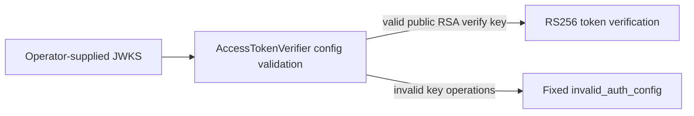

# Design

## Architecture

Validation belongs in the existing `AccessTokenVerifier` constructor, before PyJWT parses the key. No new API, state, network call, or runtime dependency is added.

## Decision

Keep `key_ops` optional for compatibility. When present, require it to be a list containing only `verify`. This is stricter than the generic JWK operation vocabulary because this component only verifies access-token signatures. Reject unsupported shape or operations with the existing fixed error.

RFC reference: [RFC 7517 §4.3, `key_ops`](https://www.rfc-editor.org/rfc/rfc7517.html#section-4.3). No live issuer conformance is claimed.

## Security and non-functional requirements

- No key material or identity data is included in errors.
- Valid public keys without `key_ops` and with `["verify"]` remain usable.
- Test behavior with ephemeral keys and no external services.
