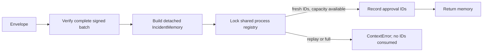

# Design

## Architecture

`IncidentMemory.from_approved_envelopes` will require an `IncidentMemoryApprovalRegistry`. The registry verifies the full bounded batch with the existing keyring verifier, constructs the memory object, then atomically checks and claims all approval IDs under a lock. The same registry object must be passed to every import in the process.

## Data and bounds

- Registry state: a set of consumed approval IDs; no incident content, signature, digest, or key material is retained.
- Default hard capacity: 10,000 IDs. Callers may choose a lower positive capacity for constrained processes/tests, never a higher one.
- No eviction or expiry-based cleanup: IDs remain claimed for the registry lifetime; full registry rejects new IDs.
- Error codes: `replayed_memory_approval`, `memory_approval_registry_full`, and `invalid_memory_approval_registry`.
- Existing signature, expiry, scope, provenance, and per-batch duplicate validation remain authoritative.

## Alternatives and trade-offs

- Stateless import: rejected because it allows repeated use in one long-lived process.
- Process-local registry: selected as an offline, bounded improvement; does not cover restart or multiple workers.
- Local SQLite or external durable registry: deferred because storage protection, encryption, retention, key trust, and multi-worker transaction semantics need a separate approved design.

## Security and reliability

Batch signature validation and memory construction happen before state mutation. Registry claims are serialized; concurrent reuse has one winner. Invalid or over-capacity batches do not partially claim IDs. The signed import factory requires this registry; it does not create persistent or cross-process guarantees.
