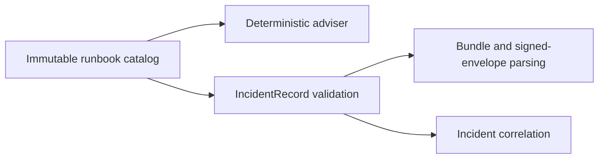

# Design

## Architecture overview

Add `scripts/devobs_intelligence/runbook_catalog.py` as the single source for the existing supported category, runbook ID, and deterministic test instruction. Keep the mapping immutable at module scope. `adviser.propose(...)` reads it to preserve its current output. `IncidentRecord` validates both its category and exact catalog ID at construction; `from_record(...)`, `from_bundle(...)`, and signed approval loading inherit the same validation through `IncidentRecord` construction.

`correlate(...)` continues to accept only `IncidentMemory` and retrieve its existing exact-scope, fresh, signed records. Since each memory row is revalidated before retrieval, a caller cannot bypass the catalog with a mutated frozen object. No new public API, record field, schema version, or persistence mechanism is introduced.

## Data model and flow

The catalog has exactly three entries:

| Category | Existing ID | Existing deterministic test instruction |
| --- | --- | --- |
| `ci_failure` | `RB-CI-01` | Check the failing CI job and compare the pinned source SHA |
| `high_error_rate` | `RB-SLO-01` | Check recent error-rate changes against approved SLO windows |
| `capacity_pressure` | `RB-CAP-01` | Review resource saturation and capacity forecasts without changing resources |

Records and bundles retain schema version 1. Valid serialized records remain byte-for-byte deterministic. An unknown ID or known-but-mismatched category/ID pair fails with the existing stable record validation error; the signed-import path surfaces the existing `invalid_memory_approval_record` wrapper. The catalog does not contain runbook bodies or executable instructions beyond the existing adviser test descriptions.

## Design decisions and alternatives

- **Chosen:** one immutable mapping shared by memory validation and the adviser. It avoids drift and preserves the three current outputs.
- **Rejected:** keep syntax-only validation. A correctly signed but semantically mismatched record could still supply a recommendation ID.
- **Rejected:** duplicate an allowlist in the memory module. It would create a second source that can diverge from the adviser.
- New categories, multiple runbooks per category, external catalogs, and configurable runbooks are deferred to a separate design because they change the trust and compatibility contract.

## Non-functional and security requirements

- Deterministic lookup with no network, filesystem, database, model, or service access.
- Fail closed at the record boundary before a row reaches memory retrieval.
- No raw incident content, identity key, or secret is added to the catalog or logs.
- Invalid historical/custom IDs become rejected inputs; no database migration is needed because this feature reads local in-process records and there is no persistent incident corpus.
- Recommendation IDs remain advisory. This change does not execute runbooks or alter approval authority.
