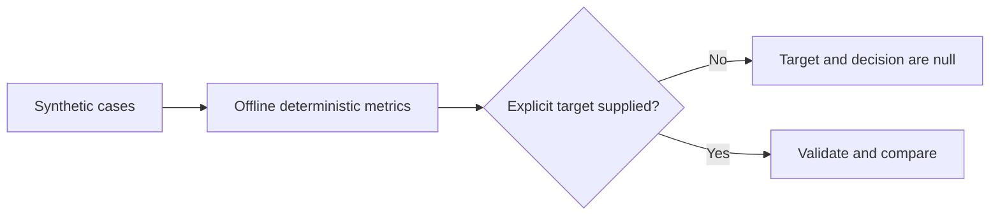

# Design

Change `evaluate_cases(cases, *, target_accuracy=...)` to use `None` as the default. Validate a target only when present; retain strict rejection of booleans, non-finite values, and values outside `[0, 1]`. Keep the same report schema keys, returning JSON-compatible `null` values for the target and target decision when no target is provided.

The evaluation algorithm and synthetic results do not change. The evaluator can prove only the comparison it computes. It cannot prove that a supplied target was approved, that the cases are representative, or that the deterministic adviser is a calibrated model.

## Data flow

## Compatibility

Report keys and all non-target values remain unchanged. The default `target_accuracy` changes from `0.85` to `null`, and default `meets_target` changes from a Boolean to `null`; consumers must treat this as an intentional schema-compatible semantic correction. Explicit target users retain existing behavior.
