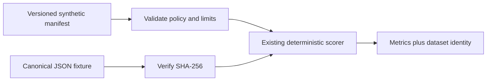

# Design

Keep `evaluate_cases()` as the in-memory scorer. Add `evaluate_fixture(root=None, target_accuracy=None)` as a repository fixture runner: it opens only fixed relative paths for the manifest and canonical JSON fixture, rejects missing/symlinked or oversized files, validates exact policy fields, verifies the raw fixture SHA-256, parses JSON with duplicate-key rejection, and checks the declared case count before calling the existing scorer.

The runner adds a bounded `dataset` object containing ID, version, SHA-256, count, synthetic label status, and `production_gate=false`. It never returns the manifest path, case IDs, labels, or signals. The module CLI prints this same JSON report and performs no provider, network, tool, or cloud operation.

The existing `validate_ai_eval_fixtures.py` validator is scoped to a different JSONL Decisions triage dataset. This feature does not change or duplicate its workflow; it binds the separate adviser fixture used by `evaluate_cases()`.

This adds reproducibility metadata only; it cannot establish reviewed labels, representativeness, model performance, safe refusal, latency, cost, or P04 exit acceptance.
