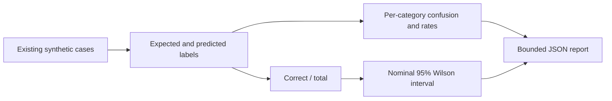

# Design

The evaluator already retains each fixture's expected and predicted category in memory while processing the case. Use those pairs to calculate one-vs-rest TP/FP/TN/FN counts for the fixed category set. Report support and prediction count; compute precision as TP/predicted-count and recall as TP/support. Keep the numerator and denominator beside each value. If a denominator is zero, return `null` for the rate.

For overall accuracy, compute the nominal 95% Wilson score interval from the count of correct cases and total cases. The input is already bounded to 1–100 cases, so the interval always has a positive denominator. Keep it descriptive and do not call it calibrated confidence.

The report keeps prior aggregate and explicit-target fields, adds no case identifiers or signal values, and does not imply safe-refusal rate, latency/cost, approval, model inference, or release readiness. The existing schema version remains unchanged because this additive result is an offline utility with no external reader in the repository; any future external consumer must review the additive fields explicitly.
