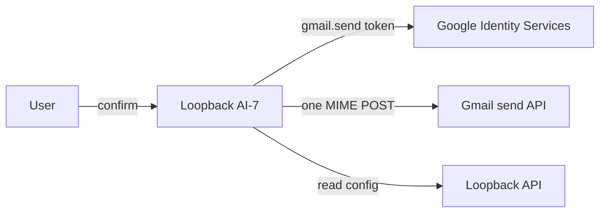

# Design

The module validates one address and builds fixed aggregate content. Loopback returns only a public client ID; the browser requests a token after confirmation and calls Gmail directly. No read scope, token storage, logging, retry or background send; an uncertain result blocks more sends in-page.
