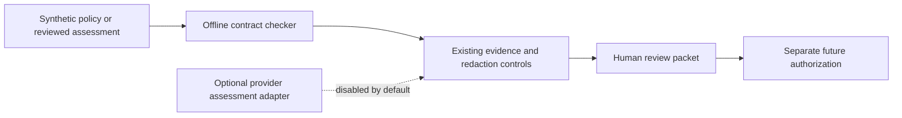

# Vendor-neutral integration readiness architecture

**VERIFIED source baseline:** `f02319237b604d5447598cfb6f2d39e66e14d3f0`;
reviewed 2026-11-21. **ASSUMED design:** optional provider assessments only.
No deployed multicloud integration is claimed. P01 remains BLOCKED/NO-GO,
AI-9 BLOCKED and Codex runtime OPEN; this change does not alter their gates.

## Existing capabilities retained

| Source | VERIFIED capability and limit |
| --- | --- |
| [CI](../../.github/workflows/ci.yml) | Existing test/security/container/Terraform checks; source is not live cloud evidence |
| [Pages release](../../.github/workflows/deploy-pages.yml) and [shared staging](../../scripts/stage_site.py) | Validated-SHA static publication; no new deployment platform or executor |
| [Terraform baseline](../../infra/terraform/main.tf) | Google Artifact Registry definition with placeholder GCS backend; not a deployed application estate |
| [Terraform guide](../../infra/terraform/README.md) | Backend-disabled validation and mock-provider plans; real apply needs separate authorization |
| [Vertex/WIF design](../VERTEX_AI_FALLBACK.md) | Existing Google identity-federation guidance; account configuration/runtime is not verified here |
| [Integration control plane](INTEGRATION_CONTROL_PLANE.md) and [engine](../../devobs/integration_control/engine.py) | Offline evidence/coordination decisions with no merge authority |
| [Human approval gate](../../scripts/human_approval_gate.py) | Deterministic Phase 8D human authority; not replaced by a provider/agent recommendation |
| [Agent operating model](../CODEX_AGENT_OPERATING_MODEL.md) | Advisory agents, explicit cost/permission boundaries; no new agent started by this contract |

GitHub Actions and the existing Google Cloud architecture remain the default
ownership path. `GITHUB_ACTIONS_GCP` below is the preserved logical default, not
a claim that the current static Pages site is hosted in GCP. No Terraform state
is imported, copied or dual-managed by Pulumi. No cloud configuration changes.

## Design and trust boundaries



**ASSUMED interface:** `assess(policy, evidence)` returns a bounded assessment;
there is no `apply`, `deploy`, `destroy`, migration or gate-continuation method.
Provider selection must be explicit: `pulumi_delivery` or `azure_catalyst`.
No provider is auto-selected from a URL, environment variable, model output or
untrusted PR text. The existing CI/deployment pipeline does not call this checker.

`DRY_RUN` is Devobs-owned **offline validation**, not `pulumi preview`, an Azure
portal operation or a promise that vendor previews have no side effects.
Live read-only calls also require separate authorization and cost/data review.

## Executable offline contract

This synthetic example is accepted by
[check_integration_readiness.py](../../scripts/check_integration_readiness.py).
Replace only the provider selector to evaluate the other design. The synthetic
SHA below is a format example, never authenticated evidence.

```json
{
  "schema_version": 1,
  "provider": "pulumi_delivery",
  "mode": "DRY_RUN",
  "read_only": true,
  "default_platform": "GITHUB_ACTIONS_GCP",
  "source_sha": "aaaaaaaaaaaaaaaaaaaaaaaaaaaaaaaaaaaaaaaa",
  "human_approval_required": true,
  "authentication_required": true,
  "auth_failure_policy": "DENY",
  "authentication_status": "NOT_CHECKED",
  "automatic_production_deployment": false,
  "audit_redaction_required": true,
  "audit_fields": [
    "event_id", "occurred_at", "provider", "source_sha", "mode",
    "auth_state", "approval_state", "decision", "reason_codes"
  ]
}
```

**VERIFIED implementation scope:** the standard-library checker validates exact
fields/types, explicit provider, preserved default, SHA format and required
safety policies. It rejects duplicate JSON keys, non-finite constants, invalid
UTF-8 and files over 16 KiB. Unknown fields, credential slots, apply modes and
self-declared verified authentication are rejected. There is no network, SDK,
credential lookup, resource discovery or provider executor.

Success means `OFFLINE_DESIGN_VALID_ONLY`, with authentication `NOT_CHECKED`,
human approval `PENDING`, and `provider_connection_verified`,
`execution_authorized` and `production_ready` all false. Missing fields fail
closed. The only/default supported mode is `DRY_RUN`; omission is invalid.
CLI exit 0 means valid design only, and exit 2 means invalid input/policy.

## Future authentication, approval and audit requirements

**ASSUMED requirements, not implemented provider controls:** authenticate only in
a separately approved trusted process. Bind the exact provider/account, allowed
operation, source SHA/artifact digest, expiry, data scope and cost ceiling to
human approval. Wrong/missing/expired credentials, authorization failures or
unavailable evidence deny the operation; never fall back to anonymous execution.
No secrets are accepted in the contract, logged, committed or read during tests.

Use the existing [control-event adapter](../../devobs/integration_control/control_events.py)
and [canonical redaction](../../devobs/integration_control/security.py) for future
structured events. An event records the listed audit fields, UTC `occurred_at`,
fixed reason codes and evidence references. Omit tokens, raw provider responses,
private inventories and credential paths. The current checker emits a sanitized
JSON **report** only; it does not implement a persistent audit sink or authenticate
audit events. Unknown input values and file paths are not echoed on validation errors.

A provider approval or AI decision cannot overwrite existing human gates. Any
future executor, webhook or live adapter is another reviewed task. Pulumi Free
manual gates are not an independent named-approver system; Azure agent access is
not an automation API. See [Pulumi](../integrations/PULUMI_DELIVERY_READINESS.md)
and [Catalyst](../integrations/AZURE_CATALYST_READINESS.md).

The local proof of concept is a synthetic file plus this checker/test suite.
It creates no pipeline, Azure project, resource, state backend or paid job.
