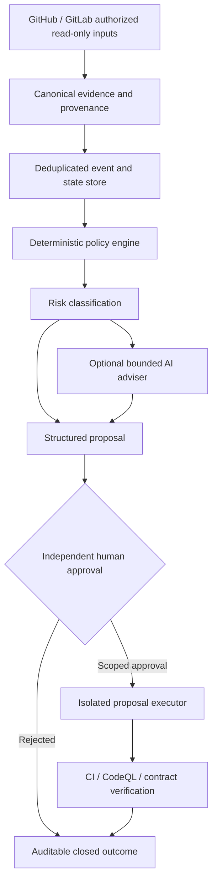

# DevObs AI Intelligence Control Plane Implementation Plan

> **For agentic workers:** Use the host's available task-by-task implementation workflow. Steps use checkbox (- [ ]) syntax for tracking.

**Goal:** Build a verified, AI-assisted DevOps control plane for GitHub/GitLab projects with human authorization for changes and a separate future SaaS option.

**Architecture:** Preserve GitHub Actions as Devobs's proven CI/CD and Pages execution engine. Add a local-first Python control plane that normalizes evidence, applies deterministic policies, optionally obtains bounded AI advice, and records verifiable proposals. Hosted APIs, tenant identity, remote workers, storage and billing are excluded until separately approved and tested.

**Tech Stack:** Existing Python 3.12/unittest, GitHub Actions, CodeQL, Bandit, pip-audit and Gitleaks; scoped GitHub/GitLab REST reads; Python stdlib for first prototype. PostgreSQL, queues, API framework, OpenTelemetry backend and hosting are future evaluation candidates, not activated services.

## Global Constraints

- GitHub repo: `hamedonassar95/Devobs`. Never push to `main` directly. Use small (<500 changed lines) isolated commits and Draft PRs.
- Do not create/change secrets, access rules, environments, resources, deployments, invoices or subscription accounts during the architecture phase.
- Preserve `AGENTS.md`, the required GitHub `validate` status, current Pages staging consistency, and the Phase 8 `PENDING HUMAN APPROVAL` rule.
- AI can recommend and explain but must never authorize its own action, alter IAM, merge, deploy, roll back, buy resources, or change billing.
- External issues, pull requests, webhooks, log records, model output and artifacts are all untrusted.
- Fail closed for missing/stale evidence, invalid JSON, duplicate delivery, unauthorized actor, expired approval, absent tool, API failure, timeout or uncertain policy decision.
- Each report distinguishes VERIFIED / INFERRED / UNVERIFIED / BLOCKED; success is defined by tests and evidence, never a promise of zero defects.
- No real inference, cloud account, scheduled job, paid service or live GitLab authentication without separate owner approval and budgets.

## Verified repository baseline — 2026-10-25

- `README.md` describes a static HTML website, not a SaaS backend or persistent multi-user service.
- `.github/workflows/ci.yml` performs change analysis, Python/Node selection, security scans and protected production release. The `validate` status check is required by the active branch ruleset.
- `agent-spec.yaml` defines advisory AI agents and budget controls; configured workflows do not prove a live AI model endpoint is available.
- `docs/PHASE8_GUARDED_RECOVERY.md` explicitly blocks autonomous production mutation, rollback and merge.
- PR #212 merged the optional GitLab read-only pipeline reader. Its connectivity does not authorize a GitHub-hosted runtime to read private GitLab projects.
- The observed main SHA at plan creation was `88e5ad4f57ccf36a9e1be6718b0d398f14a1a14c`; check it again before each task.
- The latest observed CI and CodeQL checks were successful. This does not certify overall production security or SaaS readiness.

## Target architecture



### Boundaries and data contracts (proposed)

1. `EventEnvelopeV1`: {schema_version:1, event_id, provider, project_ref, source_sha, kind, observed_at, evidence_digests}. No raw private repository contents or user PII in outputs.
2. `EvaluationV1`: {event_id, policy_version, decision: ALLOW_READ|PROPOSE_ONLY|DENY, risk: READ_ONLY|REVIEWABLE|HIGH_IMPACT, reason_codes}.
3. `ProposalV1`: {event_id, source_sha, proposal_digest, recommendation, test_plan, evidence_digests, model_metadata}. Model confidence is advisory, never authorization.
4. `ApprovalV1`: {proposal_digest, source_sha, verified_reviewer, scope, expiry, evidence_ref}. A change of source SHA or proposal digest invalidates approval.
5. `AuditRecordV1`: {sequence, previous_digest, actor_kind, decision, event_id, utc_time, evidence_digest}; redact confidential content.
6. State flow: RECEIVED -> VERIFIED -> POLICY_EVALUATED -> PROPOSED -> PENDING_HUMAN_APPROVAL -> APPROVED -> EXECUTED -> VERIFIED_OUTCOME -> CLOSED; unsupported transitions -> REJECTED or BLOCKED. No model-only path to APPROVED.
7. Initial scope is single-operator and local only. Tenant isolation, identity proof, quota billing and backups are separate release gates.

## Phase A — Local deterministic intelligence core

### Task 1: Typed evidence contract

**Files:** create `scripts/devobs_intelligence/__init__.py`, `scripts/devobs_intelligence/contracts.py`; test `tests/test_intelligence_contracts.py`.
**Consumes:** synthetic GitHub/GitLab evidence and pinned source SHA.
**Produces:** `parse_event(payload) -> EventEnvelopeV1` or fixed error code.

- [ ] Write behavior tests for valid canonical output and rejection of absent SHA, unsupported source, invalid time/type, excessive size and duplicates.
- [ ] RED: run `python3 -m unittest discover -s tests -p 'test_intelligence_contracts.py' -v`. Record a behavior-specific failure, not import or syntax failure.
- [ ] Implement the minimum bounded validator and JSON digest, no network and no private-value echo.
- [ ] GREEN: rerun the same command; require exit 0 and all relevant cases pass.
- [ ] Integration: `python3 -m compileall -q scripts tests`; require exit 0.
- [ ] Commit only those three files: `git add scripts/devobs_intelligence/__init__.py scripts/devobs_intelligence/contracts.py tests/test_intelligence_contracts.py && git commit -m "feat(intelligence): evidence contract"`.

### Task 2: Read-only evidence collectors

**Files:** create `scripts/devobs_intelligence/collectors.py` and `tests/test_intelligence_collectors.py`; reuse existing `scripts/gitlab_ci_readonly.py` without weakening its privacy design.
**Consumes:** private operator-supplied project refs and an injected GET transport.
**Produces:** canonical SHA-bound evidence, no mutation.

- [ ] Add fake-transport tests for valid pipeline, missing pipeline, stale SHA, 401/403/429, redirect, oversize, malformed JSON and connection timeout.
- [ ] RED: `python3 -m unittest discover -s tests -p 'test_intelligence_collectors.py' -v` should fail for missing collector behavior.
- [ ] Add fixed-origin, limited GETs, bounded read, timeout, strict schema and fail-closed statuses. No writes, shell or cloud.
- [ ] GREEN: repeat the focused command with exit 0; also run `python3 -m unittest discover -s tests -p 'test_gitlab_ci_readonly.py' -v`.
- [ ] Integrate with full Python test suite before review; fix regressions rather than weakening tests.
- [ ] Commit `collectors.py` and its test in a separate small commit.

### Task 3: Deterministic policy and approval gate

**Files:** create `scripts/devobs_intelligence/policy.py`, `scripts/devobs_intelligence/state_machine.py` and `tests/test_intelligence_policy.py`.
**Consumes:** evidence, requested action, independently verified approval.
**Produces:** EvaluationV1 and legal state transition; never a tool execution.

- [ ] Test unauthorized actors, stale SHA, mismatched proposal hash, duplicate approval, attempted self-approval, replay and all prohibited high-impact actions.
- [ ] RED: `python3 -m unittest discover -s tests -p 'test_intelligence_policy.py' -v` must fail specifically for missing policy.
- [ ] Implement explicit DENY for production, IAM, permission, destructive and payment operations; read-only ALLOW_READ; code changes PROPOSE_ONLY until separately authorized.
- [ ] GREEN: rerun focused tests with 0 exit; no LLM decision can change DENY to ALLOW.
- [ ] Integration: full Python unittest suite and static workflow checks pass.
- [ ] Commit these three files only, on an isolated branch.

## Phase B — Bounded AI and inspectable evidence

### Task 4: Offline-first AI adviser

**Files:** create `scripts/devobs_intelligence/adviser.py`, `tests/fixtures/intelligence_cases.json` and `tests/test_intelligence_adviser.py`.
**Consumes:** redacted evidence, explicit adapter callback, hard token/cost/retry caps.
**Produces:** ProposalV1 or BLOCKED, never an authorized command.

- [ ] Test typed response, malformed JSON, invented evidence reference, prompt injection, timeouts, quota exhaustion and unsolicited tool calls.
- [ ] RED: `python3 -m unittest discover -s tests -p 'test_intelligence_adviser.py' -v` must expose missing validation behavior.
- [ ] Implement zero live calls by default; allow injected fake model only. Bound size and retries; strict output schema and evidence allowlist.
- [ ] GREEN: repeat focused tests and full suite; expected zero failed tests and zero external calls.
- [ ] Compare fake-model recommendations to the rule-only baseline; label accuracy/cost UNVERIFIED until an owner-approved live measurement.
- [ ] Commit three files only; keep production connections disabled.

### Task 5: Idempotent audit store and local operator report

**Files:** create `scripts/devobs_intelligence/audit_store.py`, `scripts/intelligence_report.py` and `tests/test_intelligence_audit_store.py`.
**Consumes:** validated event and evaluation records.
**Produces:** local SQLite evidence ledger and redacted JSON status report.

- [ ] Add failing tests for duplicate event, corrupted audit chain, missing database, invalid state, confidential input and schema mismatch.
- [ ] RED: `python3 -m unittest discover -s tests -p 'test_intelligence_audit_store.py' -v` shows absent ledger.
- [ ] Implement a local single-writer ledger with append-only logical semantics, digest linkage and JSON export excluding credentials and private content.
- [ ] GREEN: the focused test exits 0; full test discovery passes.
- [ ] Verify synthetic report stays read-only and displays no private identifiers.
- [ ] Commit ledger, report command and tests separately.

## Phase C — Guarded proposals and SaaS prerequisites

### Task 6: Explicitly approved Draft-PR proposer

**Files:** create `scripts/devobs_intelligence/proposal_adapter.py` and `tests/test_intelligence_proposal_adapter.py`.
**Consumes:** allowed file list, immutable SHA, proposal digest, authenticated separate approval.
**Produces:** one idempotent new-branch Draft PR, never an autonomous merge/deploy.

- [ ] Write fake-GitHub tests for no approval, mismatched SHA, protected file, duplicate request, GitHub error and wrong target repo.
- [ ] RED: `python3 -m unittest discover -s tests -p 'test_intelligence_proposal_adapter.py' -v` demonstrates missing boundary.
- [ ] Implement recording/fake adapter by default; allowed writes are only new feature branch and Draft PR after separate owner approval. No changes to main, security settings, billing or infrastructure.
- [ ] GREEN: repeat test with 0 exit; full CI and security jobs must pass.
- [ ] Require fresh separate authorization before any live repository-write test.
- [ ] Commit adapter and its tests on a reviewable branch.

### Task 7: Tenant-isolation and SaaS release gate

**Files:** create `docs/AI_INTELLIGENCE_SAAS_GATE.md` and `tests/test_intelligence_tenant_isolation.py`; future services under `services/` and `infra/` are proposals only.
**Consumes:** verified operator identity, project-scoped permission and retention policy.
**Produces:** negative isolation tests and reviewed go/no-go decision, not a hosted application.

- [ ] Add failing tests proving tenant A cannot read, act upon or infer tenant B's events and approvals.
- [ ] RED: `python3 -m unittest discover -s tests -p 'test_intelligence_tenant_isolation.py' -v` fails on absent tenant boundary.
- [ ] Implement only the narrow offline authorization seam and document required service identity, per-tenant storage/worker credentials, network isolation, quotas, retention, backup, export/deletion, abuse monitoring and account administration.
- [ ] GREEN: rerun the same test with 0 exit, including cross-tenant negative tests.
- [ ] Review hosting, identity provider, database, regions, pricing and consent before any cloud provisioning or customer onboarding.
- [ ] Commit gate, tests and pure authorization seam in isolated changes under 500 lines each.

## Definition of Done and evidence gates

| Area | Evidence required | Never infer from |
|---|---|---|
| Core correctness | All focused red-green tests and full unittest pass | Source existence alone |
| CI integrity | Required validate successful on exact PR SHA | Old green main workflow |
| Security | Gitleaks, Bandit, pip-audit, CodeQL outcomes reviewed; no high-risk unresolved finding | A single green scanner |
| Source trust | Events pinned to verifiable current source SHA; replay is rejected | User/model description |
| Approval | High-impact action blocked in negative tests; independent approval tied to SHA and scope | An AI confidence score |
| Reliability | Timeout/429/missing data paths fail closed, duplicates handled idempotently | Happy-path tests alone |
| Operational readiness | Structured audit records, synthetic incident drill and documented manual recovery procedure | Static dashboard screenshot |
| SaaS readiness | Tested cross-tenant isolation, verified auth, backup restore test, support/privacy/cost controls | An API or website existing |

### Shared verification commands

Run from repository root in every later code PR:

```bash
python3 -m compileall -q scripts tests
python3 -m unittest discover -s tests -v
node --test tests/incident_guard.test.cjs
python3 scripts/check_site.py
```

The commands must exit 0. Check the PR's required `validate` result and relevant security/CodeQL results. If a tool, test, credential or environment is unavailable, report BLOCKED instead of calling the milestone complete.

## Explicit decisions reserved for the owner

- Start single-operator/offline; customer signup and SaaS monetization require a new scope approval.
- No default cloud location, database, payment processor or subscription plan is selected.
- No AI inference provider is activated by this plan. Choose one only after measuring quality, cost and privacy.
- Production deployment, permission/IAM changes, rollback and billing remain human-controlled.
- Optional read-only scheduled reporting can be considered only after verified connector credentials and an explicit cadence.
- Real-time dashboard, webhook ingestion, OpenTelemetry backend and durable hosted queue are gated on a tested control plane and operator acceptance.

## Evidence and official references

- Repo: `AGENTS.md`, `agent-spec.yaml`, `.github/workflows/ci.yml`, `docs/PHASE8_GUARDED_RECOVERY.md`, `docs/GITLAB_READONLY_CI_AUDIT.md`.
- GitHub OIDC: https://docs.github.com/en/actions/reference/security/oidc
- GitLab REST authentication: https://docs.gitlab.com/api/rest/authentication/
- GitLab pipelines: https://docs.gitlab.com/api/pipelines/
- OWASP AI Agent Security: https://cheatsheetseries.owasp.org/cheatsheets/AI_Agent_Security_Cheat_Sheet.html
- OpenTelemetry signals: https://opentelemetry.io/docs/concepts/signals/

**State:** This is the architecture and implementation plan only. No task is claimed implemented simply because this file exists.
